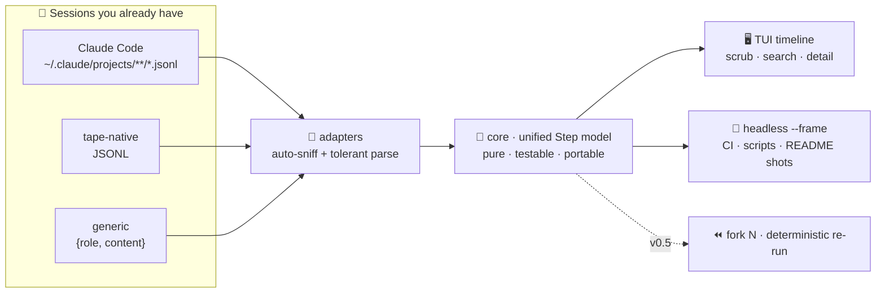

<div align="center">

<!-- Logo 占位：替换为 480×120 的 PNG/DBG banner -->
<!--  -->

```
   _______________
  ⏪  tape          time-travel debugger
   ‾‾‾‾‾‾‾‾‾‾‾‾‾‾‾  for AI agent sessions
```

**Your agent ran all night. Something broke at step 15. Which step was 15?**

[](https://github.com/ecoreal/tape/actions/workflows/ci.yml)
[](https://www.npmjs.com/package/tape-replay)
[](LICENSE)
[](#%EF%B8%8F-tech-stack--why)
[](package.json)
[](https://github.com/ecoreal/tape/stargazers)
[](#-contributing)

*Zero dependencies · Zero config · Zero cloud. Reads the JSONL your agent already writes.*

</div>

---

## ✨ Core Features

- 📼 **Time-travel scrubbing** — `j/k` through every step of an agent session like a video editor; the detail pane shows exactly what the agent saw, including full tool output.
- 🔌 **Reads what you already have** — Claude Code session files, tape-native JSONL, and generic `{role, content}` lines. No SDK, no instrumentation, no re-running anything.
- 🔍 **Search across everything** — one keystroke jumps to the first mention of that `ECONNRESET` you're hunting.
- 🛡 **Never crashes on your data** — malformed lines are skipped and counted, never fatal. Real transcripts are messy; tape expects it.
- 🤖 **Headless mode** — `--frame N --plain` renders any moment to stdout: scriptable, CI-friendly, and it's how every screenshot in this README was made (no image editor involved).
- 🪶 **Zero runtime dependencies** — ~20 KB of JavaScript. Nothing to audit, nothing to break, `npx` and go.

## 🧭 How It Works



The core knows nothing about files, terminals, or networks — which is why frames render identically in a TTY, in CI, and in this README. (Full design: [docs/ARCHITECTURE.md](docs/ARCHITECTURE.md))

## 🚀 Quick Start (30 seconds, two commands)

```bash
npx tape-replay demo                    # ① writes a 25-step sample session (~1s)
npx tape-replay demo-session.jsonl      # ② opens the timeline — scrub with j/k
```

Point it at a real session instead:

```bash
tape ~/.claude/projects/<your-project>/<session>.jsonl
```

<details>
<summary>🖥 No TTY? (CI, scripts, piping)</summary>

```bash
tape demo-session.jsonl --frame 8 --plain   # render any moment to stdout
```
</details>

<details>
<summary>⚙ Scripting — <code>--json</code> everywhere</summary>

Every reporting command (`stats`, `diff`, `grep`, `cache`) takes `--json`: stable single-line JSON on stdout, nothing else on the pipe. Human output is unchanged without the flag, and errors always go to stderr with exit code 1 — so scripts can trust it:

```bash
tape stats session.jsonl --json | jq .cost        # 0.139
tape grep ECONNRESET --json | jq -r '.[].path'    # which sessions mention it
tape diff run-a.jsonl run-b.jsonl --json | jq .divergence
```
</details>

| key | action | key | action |
|---|---|---|---|
| `↑/↓` `j/k` | select step | `/` | search |
| `J/K` | scroll detail | `g` / `G` | first / last |
| `?` | help | `q` | quit |

Also: `tape stats [file]` (cost/tokens summary), `tape diff a.jsonl b.jsonl` (where two runs split), `tape adapters` (which session formats tape reads — and how to add one), and `tape <file> --follow` — tail a session while the agent is still writing it.

## 📸 Showcase

<!-- GIF 占位：用 vhs 从 demo 生成 15s 录屏，放 docs/demo.gif -->
<!--  -->

**Real output, no paint** — the moment a test run fails (rendered by `tape --frame 8 --plain`):

```
⏪ tape examples/demo-session.jsonl 25 steps
┌──────────────────────────────────┬──────────────────────────────────────────┐
│  U The login page 500s intermit… │tool_result  2026-10-25 12:06:27          │
│  A I'll reproduce the failure f… │                                          │
│  T Read src/auth/session.ts      │> npm test -- tests/auth.test.js          │
│  R 14 | export async function r… │                                          │
│  T Read src/auth/login.ts        │  ✗ concurrent refresh keeps one session  │
│  R 31 | router.post('/login', a… │row (2 racing requests)                   │
│  A Suspicious: refreshSession r… │  ✗ token from refresh is usable on next  │
│  T Bash npm test -- tests/auth.… │request                                   │
│  R > npm test -- tests/auth.tes… │  ✗ login returns 200 under load          │
│  A 3 failures, all around concu… │  9 passed · 3 failed                     │
│  T Edit src/auth/session.ts (+1… │                                          │
│  T Bash npm test -- tests/auth.… │                                          │
│  ! fetch failed: ECONNRESET — t… │                                          │
│  A The DB container crashed mid… │                                          │
│  T Bash docker restart pg-test … │                                          │
│  R > npm test -- tests/auth.tes… │                                          │
│  A Root cause: token refresh ra… │                                          │
│  U nice. add a regression test … │                                          │
│  T Edit tests/auth.test.js (+31) │                                          │
└──────────────────────────────────┴──────────────────────────────────────────┘
↑↓ select · / search · ? help · q quit 9/25
```

<!-- 更多展示位：docs/screenshot-search.png（搜索 ECONNRESET 跳转）· docs/screenshot-real.png（真实 Claude Code 会话） -->

### 📊 `tape stats` — what that session actually cost you

```
⏪ tape — stats  ~/.claude/projects/<project>/<session>.jsonl

steps        14  user 2 · tool_use 5 · tool_result 5 · assistant 2
duration     18m47s
cost         $0.139
tokens       in 52.9k · out 2.3k
models       z-ai/glm-5.3 (7)
top tools    Bash 4 · Read 1

activity     ▁▁▄▁▁▁▄█▁▁▁▄▆▁
```

*(real output from a real session — every number was already sitting in the JSONL)*

## 🆚 Why tape

| today's options | the pain |
|---|---|
| Langfuse / AgentOps | SDK in your code, an account, sessions leave your machine |
| dashboard observability | services to run, a web UI to click through for one question |
| `less session.jsonl` | a wall of JSON — no timeline, no types, no search |
| `--resume` flags | continues a session, can't *inspect* one |

## 🗺 Roadmap

- ~~v0.5: `tape fork` + rerun~~ ✅ **shipped** — `tape fork <file> <N>` branches a session ($EDITOR edit of step N when interactive), `tape rerun` continues it (`echo` provider offline, any OpenAI-compatible endpoint via `TAPE_API_KEY`). `fork → rerun → diff` is offline prompt A/B testing.
- next: tool-result caching across reruns (identical tool calls served from the original session — zero cost re-runs), more adapters (OpenClaw…), GIF export.

## 🤝 Contributing

Small, sharp PRs welcome — this codebase is deliberately tiny (~1.5k lines, zero deps) so you can hold it all in your head.

**🏆 Best first PR: a session-format adapter** (~20 lines). The contract is [docs/adapter-spec.md](docs/adapter-spec.md) — the unified Step model, the claude-code mapping table, tolerance rules, and a copy-paste golden-test recipe; `tape adapters` lists what's built in. [src/parse.js](src/parse.js) (`normalize()`) remains the reference implementation. Bug reports with a *redacted* transcript that fails to parse are gold.

```bash
git clone https://github.com/ecoreal/tape && cd tape
npm test          # node:test — zero config
```

Issues labeled [`good first issue`](https://github.com/ecoreal/tape/labels/good%20first%20issue) are pre-scoped. Be kind; we're all debugging agents at 2am.

## 🙏 Acknowledgments

- **git bisect** and the **Chrome DevTools** Performance panel — the two great time-travel UIs tape humbly imitates.
- **Langfuse** & **AgentOps** — they built the cloud version of this problem; tape exists for everyone who wants the local one.
- Every terminal emulator that correctly renders `─` and `│`. You know who you are.

## 📄 License

[MIT](LICENSE) © 2026 tape contributors
